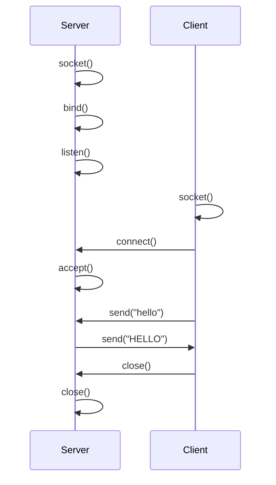

# MUHAMMAD IMAMUL KHAIR BIN AMERAN
# 2024432804 
# Network Programming with C

**Course:** Computer Networks, Bachelor of Computer Science

**Demo video:** [Watch on YouTube](YOUTUBE_LINK_HERE)

---

## 1. Introduction

Every time a phone loads a web page, sends a chat message or syncs a file, two programs are talking to each other across a network. Network programming is the skill of writing those programs. In this article I explain the basics of network programming in C and build a small working example: a TCP server that receives a message from a client, records it with a timestamp, and sends it back in capital letters.

C is a good language for learning this topic for three reasons. First, the socket interface that almost every other language uses (Python, Java, Node.js and so on) was originally designed for C on Unix, so learning it in C shows what is really happening underneath. Second, C gives direct control over the system calls, so nothing is hidden. Third, a lot of real network software, including web servers and network tools, is still written in C.

By the end of this article you will understand what a socket is, how a TCP connection is set up, and how to compile and run a client and server of your own. A video demonstration is linked at the top of this page.

## 2. Background

### 2.1 What is a socket?

A socket is an endpoint for communication provided by the operating system. A program asks the operating system for a socket, and the operating system returns a **file descriptor**, which is just an integer. The program then reads from and writes to that descriptor in much the same way it would use a file, except the data travels over the network.

Each side of a conversation is identified by an **IP address** (which machine) and a **port number** (which program on that machine). For example, `127.0.0.1:8080` means "port 8080 on this same computer", where `127.0.0.1` is the loopback address used for testing.

### 2.2 TCP and UDP

Two transport protocols are used most often, and sockets can use either:

| | TCP (`SOCK_STREAM`) | UDP (`SOCK_DGRAM`) |
|---|---|---|
| Connection | Connection-oriented (a connection is set up first) | Connectionless |
| Reliability | Lost data is detected and resent | No guarantee of delivery |
| Order | Data arrives in order | Order is not guaranteed |
| Typical use | Web pages, email, file transfer | Video calls, online games, DNS |

This project uses TCP because a simple message exchange benefits from reliable, ordered delivery. TCP is defined in RFC 9293 and UDP in RFC 768 (see References).

### 2.3 Where sockets fit in the TCP/IP model

| Layer | Role | Examples |
|---|---|---|
| Application | The program itself and its message format | HTTP, our client and server |
| Transport | Delivers data to the right program using port numbers | TCP, UDP |
| Internet | Routes packets between machines | IP |
| Network access | Sends bits over the physical medium | Ethernet, Wi-Fi |

The sockets API sits between the application layer and the transport layer. Our program only decides what to send; the operating system handles TCP, IP and the network card.

## 3. How a TCP client and server talk

A TCP server and client follow a fixed sequence of system calls:



In plain words:

1. **`socket()`** asks the operating system for a new socket.
2. **`bind()`** (server only) attaches the socket to a port, so clients know where to find it.
3. **`listen()`** (server only) marks the socket as ready to accept incoming connections and sets how many can wait in the queue.
4. **`connect()`** (client only) starts the connection to the server's address and port.
5. **`accept()`** (server only) takes one waiting connection and returns a **new** descriptor dedicated to that client. The original socket keeps listening for more clients.
6. **`send()` and `recv()`** transfer data in both directions.
7. **`close()`** ends the connection and frees the descriptor.

## 4. The program

The project has two source files:

| File | Purpose |
|---|---|
| [`server.c`](server.c) | Listens on port 8080, logs each message with a timestamp, replies in uppercase |
| [`client.c`](client.c) | Connects to the server, sends what the user types, prints the reply |

### 4.1 Server walkthrough

**Creating and configuring the socket.**

```c
server_fd = socket(AF_INET, SOCK_STREAM, 0);
if (server_fd < 0) { perror("socket"); exit(EXIT_FAILURE); }

int opt = 1;
setsockopt(server_fd, SOL_SOCKET, SO_REUSEADDR, &opt, sizeof(opt));
```

`AF_INET` selects IPv4 and `SOCK_STREAM` selects TCP. The `SO_REUSEADDR` option lets the server restart immediately on the same port. Without it, the operating system may refuse the port for a short time after the server stops, with an "Address already in use" error.

**Binding to a port.**

```c
server_addr.sin_family = AF_INET;
server_addr.sin_addr.s_addr = INADDR_ANY;
server_addr.sin_port = htons(PORT);

bind(server_fd, (struct sockaddr *)&server_addr, sizeof(server_addr));
```

`INADDR_ANY` means the server accepts connections on every network interface of the machine. `htons()` converts the port number into **network byte order** (big-endian), because different computers store numbers in different byte orders and the network needs one agreed format.

**Listening and accepting.**

```c
listen(server_fd, 5);

client_fd = accept(server_fd, (struct sockaddr *)&client_addr, &client_len);
```

The value `5` is the backlog: the number of connections allowed to wait in the queue. `accept()` blocks (waits) until a client connects, then fills `client_addr` with the client's address and returns the new descriptor `client_fd`.

**The receive-and-reply loop.**

```c
while ((n = recv(client_fd, buffer, BUF_SIZE - 1, 0)) > 0) {
    buffer[n] = '\0';
    /* log the message with a timestamp */
    for (ssize_t i = 0; i < n; i++)
        buffer[i] = toupper((unsigned char)buffer[i]);
    send(client_fd, buffer, n, 0);
}
```

`recv()` returns the number of bytes received. A return value of `0` means the client closed the connection, and `-1` means an error. After receiving, the server adds a string terminator, prints a timestamped log line, converts every character to uppercase, and sends the result back.

### 4.2 Client walkthrough

```c
sock = socket(AF_INET, SOCK_STREAM, 0);

server_addr.sin_family = AF_INET;
server_addr.sin_port = htons(PORT);
inet_pton(AF_INET, server_ip, &server_addr.sin_addr);

connect(sock, (struct sockaddr *)&server_addr, sizeof(server_addr));
```

The client creates its own socket, fills in the server's address (`inet_pton()` converts the text `127.0.0.1` into the binary form the system needs), and calls `connect()`. It does **not** call `bind()`; the operating system automatically picks a free temporary port for the client.

After connecting, the client loops: read a line from the keyboard with `fgets()`, `send()` it, wait for the reply with `recv()`, and print it. Typing `quit` leaves the loop and closes the socket.

### 4.3 Error handling

Every important call (`socket`, `bind`, `listen`, `accept`, `connect`, `send`) is checked for failure, and `perror()` prints a readable reason such as "Address already in use" or "Connection refused". Network code fails often for reasons outside the program's control (the server is not running, the port is taken, the network drops), so checking return values is part of writing correct code, not an optional extra.

## 5. How to compile and run

**Requirements:** a Linux environment with `gcc` (Ubuntu, WSL2 on Windows, or macOS with Xcode command line tools).

```bash
git clone https://github.com/YOUR-USERNAME/network-programming-c.git
cd network-programming-c

gcc -Wall -o server server.c
gcc -Wall -o client client.c
```

Open two terminal windows.

**Terminal 1 (server):**

```bash
./server
```

**Terminal 2 (client):**

```bash
./client
```

To connect to a server on another computer, give the client its IP address, for example `./client 192.168.1.5`.

### Example session

Client terminal:

```
Connected to 127.0.0.1:8080. Type a message (or 'quit').
> hello networks
Server replied: HELLO NETWORKS
> sockets are fun
Server replied: SOCKETS ARE FUN
> quit
```

Server terminal:

```
Server listening on port 8080...
[2026-10-22 15:04:11] Client connected: 127.0.0.1:52344
[2026-10-22 15:04:16] Received: hello networks
[2026-10-22 15:04:21] Received: sockets are fun
[2026-10-22 15:04:25] Client disconnected
```


## 6. Limitations and possible improvements

This is a learning example, not a production server, and it has some clear limits:

- **One client at a time.** The server finishes with one client before accepting the next. A real server would use `fork()`, threads, or `select()`/`poll()` to serve many clients at once.
- **TCP is a byte stream, not a message stream.** Two `send()` calls can arrive in one `recv()`, and one large message can arrive in pieces. This demo works because the messages are short, but a real protocol needs a way to mark where a message ends, such as a length prefix or a delimiter.
- **IPv4 only.** Supporting IPv6 means using `getaddrinfo()` and `AF_INET6` or address-family-independent code.
- **No encryption.** Anything sent is readable by anyone watching the network. Real applications add TLS.

## 7. Conclusion

This project shows the core of network programming in C: create a socket, give the server an address, listen, connect, exchange data with `send()` and `recv()`, and close cleanly. The same sequence of calls sits underneath much larger systems, even when a higher-level language hides it. The next steps would be handling multiple clients at once and designing a proper message format on top of the byte stream.

## 8. References

1. Hall, B. (n.d.). *Beej's Guide to Network Programming*. https://beej.us/guide/bgnet/
2. The Linux man-pages project. *socket(2)*. https://man7.org/linux/man-pages/man2/socket.2.html
3. The Linux man-pages project. *bind(2)*. https://man7.org/linux/man-pages/man2/bind.2.html
4. The Linux man-pages project. *listen(2)*. https://man7.org/linux/man-pages/man2/listen.2.html
5. The Linux man-pages project. *accept(2)*. https://man7.org/linux/man-pages/man2/accept.2.html
6. The Linux man-pages project. *connect(2)*. https://man7.org/linux/man-pages/man2/connect.2.html
7. The Linux man-pages project. *send(2)*. https://man7.org/linux/man-pages/man2/send.2.html
8. The Linux man-pages project. *recv(2)*. https://man7.org/linux/man-pages/man2/recv.2.html
9. Eddy, W. (2022). *Transmission Control Protocol (TCP)* (RFC 9293). IETF. https://www.rfc-editor.org/rfc/rfc9293
10. Postel, J. (1980). *User Datagram Protocol* (RFC 768). IETF. https://www.rfc-editor.org/rfc/rfc768
11. Elçi, U. (2025, August 17). *Introduction to Network Programming in C: Fundamentals and Sockets*. Medium. https://medium.com/@umutcanelci/introduction-to-network-programming-in-c-fundamentals-and-sockets-8226e5ef4dc7
